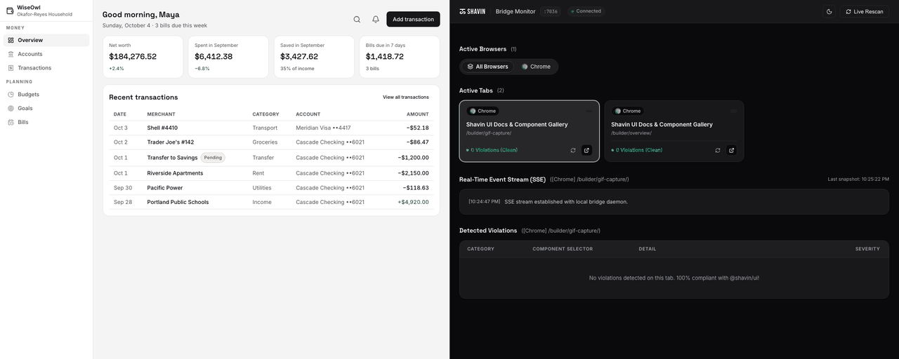

<div align="center">

[](https://shavin.cc)

# `@shavin/ui`

### Enterprise React design system & AI-ready component engine

**Beta** · React 19 · Next.js and Vite · Tailwind v3 and v4

[](./LICENSE)
[](./.nvmrc)
[](./packages/ui)
[](./packages/mcp-server)
[](#what-makes-it-different)

**[Website](https://www.shavin.cc)** · **[Docs](https://docs.shavin.cc)** · **[Contributing](./CONTRIBUTING.md)**

</div>

---

`@shavin/ui` is a production-grade React design system engineered for teams that build with AI coding agents. It pairs 94 accessible primitives and a strict two-tier token system with a Model Context Protocol server that hands agents the real component APIs, the design rules, and live-DOM auditing. People and agents compose from one source of truth, so generated interfaces come out design-compliant and accessible — built, not improvised.

> [!NOTE]
> **Beta.** Component APIs and tokens can still change between releases. Install with the command under [Get started](#get-started); to work on it from source, see [Develop](#develop).


## Contents

- [What makes it different](#what-makes-it-different)
- [Packages](#packages)
- [Get started](#get-started)
- [For AI agents](#for-ai-agents)
- [Develop](#develop)
- [Contributing](#contributing)

## What makes it different

| Capability | What you get |
|---|---|
| **Agent&#8209;native** | An MCP server exposes real component APIs, tokens and rules, validates and autofixes generated code, and audits the live DOM in your browser. Agent skills teach layout, typography and motion judgement. |
| **Two&#8209;tier&nbsp;tokens** | A foundation palette maps to role-based semantic utilities (`bg-surface`, `text-fg`, `border-hairline`). Brand colours and dark mode change without touching component code. |
| **Concentric&nbsp;geometry** | Nested surfaces keep their curves in step: R<sub>inner</sub> = max(floor, R<sub>outer</sub> − P). |
| **Accessible&nbsp;by&nbsp;default** | Built on Radix and WAI-ARIA patterns. Keyboard, focus and screen-reader behaviour is held to **WCAG 2.2 AA**, covered by an automated axe plus browser accessibility test suite. |
| **Motion&nbsp;built&nbsp;in** | Token-driven reveals, scroll choreography, and a timeline runtime for element and split-text animation — all honouring `prefers-reduced-motion`. |
| **Tailwind&nbsp;v3&nbsp;&&nbsp;v4** | A v3 preset and a v4 `@theme` bridge, each in RGB or OKLCH. |

## Packages

| Package | What it is |
|---|---|
| [`@shavin/ui`](./packages/ui) | 94 React primitives on Radix, two-tier tokens, Tailwind v3 preset and v4 theme ([component docs](https://docs.shavin.cc/components/overview)) |
| [`@shavin/cli`](./packages/cli) | `npx @shavin/cli init` wires Tailwind, styles, ThemeProvider, brand tokens and agent config; `brand` sets colour, fonts and mode in one step; `findings` hands findings sent from the page to an agent; `add` installs blocks |
| [`@shavin/mcp`](./packages/mcp-server) | MCP server: component APIs, tokens and rules for agents, code validation and autofix, live browser audit ([overview](https://www.shavin.cc/mcp)) |
| [`@shavin/skills`](./packages/skills) | Design-judgement skills and slash commands for AI coding agents |
| [`@shavin/block-schema`](./packages/block-schema) | Block types, schemas and the open block catalogue ([browse blocks](https://www.shavin.cc/blocks)) |

## Get started

Next.js and Vite (with React 19) are supported today. Other frameworks are planned for later and not available yet; `init` stops with an error, and changes nothing, in any other project. One command sets up an existing Next.js or Vite app:

```sh
npx @shavin/cli init
```

`init` detects your Tailwind version and package manager, then:

- installs `@shavin/ui`, and offers to add `@shavin/mcp` and `@shavin/skills` for your agents
- wires Tailwind: the preset and content path on v3, the theme bridge and `@source` on v4
- imports the Shavin stylesheet and your brand tokens
- wraps the root layout in `<ThemeProvider>`
- writes `SHAVIN.md`, the project's design brief for people and agents
- installs agent skills into `.agents/` and registers the MCP server for Claude Code, Cursor and VS Code
- wires the Agent-Browser bridge to start with your dev server (Next or Vite)

Run it as `npx @shavin/cli init --oklch` to use the OKLCH colour space instead (wider gamut, perceptually even colours). Check the wiring at any time with `npx @shavin/cli check`.

### Use it

```tsx
import { Button, Card, Flex, Heading, Text } from "@shavin/ui";

export function Welcome() {
  return (
    <Card padding="md" className="max-w-sm">
      <Flex direction="column" gap="3">
        <Heading as="h3" size="md">Getting started</Heading>
        <Text color="subtle" size="sm">Every colour, radius and space here comes from the token system.</Text>
        <Button variant="solid" size="sm">Explore components</Button>
      </Flex>
    </Card>
  );
}
```

## For AI agents

### MCP server

Add `@shavin/mcp` to your editor (`init` does this for you):

```json
{
  "mcpServers": {
    "shavin": { "command": "npx", "args": ["-y", "@shavin/mcp"] }
  }
}
```

The same block works in `.mcp.json` (Claude Code), `.cursor/mcp.json`, `.vscode/mcp.json` and `claude_desktop_config.json`.

**On Windows,** use this instead. `init` writes it for you.

```json
{ "command": "cmd", "args": ["/c", "npx", "-y", "@shavin/mcp"] }
```

Some editors can't start `npx` directly on Windows, so this runs it through `cmd`. If you see `spawn npx ENOENT`, this is the fix.

#### Tools

There are 36 tools in all. An agent sees 22 of them by default: the Studio tools appear once a Studio session is connected, and the live-audit and findings tools once a browser tab is connected. Set `SHAVIN_MCP_ALL_TOOLS=1` to list all 36.

| Group | Tools |
|---|---|
| **Plan the page** | `plan_page`, `check_page` |
| **Learn the system** | `get_components`, `get_tokens`, `get_guidelines`, `get_setup_instructions`, `get_project_context`, `get_studio_schema`, `get_block_template` |
| **Check and fix code** | `validate_code`, `autofix_code`, `audit_source`, `inspect_environment`, `render_check` |
| **Compose** | `synthesize_layout`, `shavin_steer` |
| **Skills** | `list_skills`, `get_skill`, `get_skill_mode`, `install_skills`, `list_commands` |
| **Live browser audit** | `get_live_audit`, `trigger_live_rescan`, `wait_for_live_clean` |
| **Findings from the page** | `await_finding`, `list_findings` |
| **Shavin Studio relay** | `connect_studio`, `compose_to_canvas`, `inject_blocks`, `get_studio_state`, `set_studio_theme`, `clear_studio_canvas`, `duplicate_frame`, `resize_frame`, `export_frame`, `disconnect_studio` |

`shavin_steer` runs high-level design moves — `audit`, `polish`, `harden`, `typeset`, `anti-slop`, `rollback`, `init_brain` (creates `SHAVIN.md` when it is missing). Every tool result ends with a short `Next:` line naming the following step, so an agent stays on the workflow even when a host drops the server instructions.

### Live browser audit (`:7036`)

The bridge lets an agent see the page you are looking at: in development, `<ThemeProvider>` streams DOM snapshots to it on port 7036, so the agent can read token violations and contrast failures and wait until they reach zero. Open `http://localhost:7036/` for the dashboard.

`shavin init` installs `@shavin/mcp` (it asks first) and wires the bridge into your Next or Vite config, so it starts with your project's dev server. It also starts whenever an agent starts `@shavin/mcp`.

Only if you need it:

- **Skipped `init` or the agent tools, or `init` could not edit your config:** wrap the config yourself with `withShavinBridge` (`@shavin/mcp/next`) or add the `shavinBridge()` plugin (`@shavin/mcp/vite`).
- **No agent running, or no `init`:** run `npx @shavin/cli bridge` next to your dev server (Next.js or Vite).
- **Opt out:** set `SHAVIN_BRIDGE=0`.
- **Custom port:** point the browser at it with `NEXT_PUBLIC_SHAVIN_BRIDGE_PORT` / `VITE_SHAVIN_BRIDGE_PORT`, or `<ThemeProvider bridgePort={…}>`.



### Skills and project memory

`npx @shavin/skills` installs design-judgement skills and slash commands into `.agents/`:

| Skill | Use it for |
|---|---|
| `shavin-app` | Dashboards, SaaS apps and admin consoles |
| `shavin-webpage` | Marketing and landing pages |
| `layout-compositions` | 57 section layouts in 9 families, with selection rules |
| `visual-compositor` | Composition, typography, polish and the anti-pattern list (AP-01 to AP-13) |
| `layout-motion` / `layout-choreography` | Restrained motion, then cinematic scroll scenes |
| `shavin-studio` | Only while a Studio session is connected, or designing a block in isolation for approval |

`SHAVIN.md` at your project root records the brand colour, gray, density and radius choices so every session, human or agent, starts from the same brief. `.shavin/` holds generated prompt context and rollback snapshots.

## Develop

```sh
nvm use            # Node 22
npm install
npm run playground # preview every primitive from source at localhost:3700
npm run verify     # build, typecheck, token lint, manifests, skills
npm test           # unit tests
npm run eval       # score recorded AI output against the design rules
npm run smoke      # install the packed packages into a fresh Next.js + Tailwind v4 app
```

[CONTRIBUTING.md](./CONTRIBUTING.md) explains when to run each one. Agents working in this repo should read [AGENTS.md](./AGENTS.md).

## Contributing

Contributions are welcome. Read [CONTRIBUTING.md](./CONTRIBUTING.md), then the [contributor docs](./docs/README.md) for where things live and how to work on each package; every commit needs a DCO sign-off (`git commit -s`). Some tooling and hosted services are maintained separately — [CONTRIBUTING.md](./CONTRIBUTING.md#whats-not-open) says what is and isn't open.

## Licence

[MIT](./LICENSE) © 2026 Avinash Bussa and Shavin contributors. "Shavin" and the Shavin product names are trademarks of Avinash Bussa.
